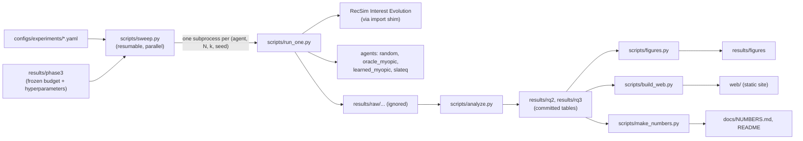

# SlateQ vs myopic slate recommendation in RecSim

MS course project, CSCI 5933 Reinforcement Learning, University of Colorado Denver (Darshankumar Jikadara).

A recommender shows each user a **slate** of k items chosen from N candidates. A **myopic** recommender
shows what is most likely to be clicked now. **SlateQ** (Ie et al., 2019) learns the long-term value of
each item and stays tractable by decomposing a slate's value into per-item values. We test, in RecSim's
Interest Evolution simulator, whether that long-term view actually yields more engagement per session.

| | Research question |
|---|---|
| **RQ1** | Does SlateQ give higher long-term engagement (total watch time per session) than a myopic recommender? |
| **RQ2** | How does that gap change with catalog size N (candidates per step) and slate size k? |
| **RQ3** | How sensitive is SlateQ's advantage to a misspecified user choice model? |

**Interactive results:** the static site in [`web/`](web/) (overview, RQ1-RQ3, and a step-by-step replay of one simulated user under every policy). It is deployed on Vercel as a static folder (`vercel.json`, `.vercelignore`: only `web/` is uploaded, nothing is built).

## Results

<!-- RESULTS:START -->
_Generated by `scripts/make_numbers.py`; full tables in [docs/NUMBERS.md](docs/NUMBERS.md), figures in [results/figures](results/figures)._

- **RQ1** (N=10, k=3, 5 seeds): SlateQ - learned-myopic = **+1.70** watch time per session, 95% CI [+1.54, +1.85]; first higher (clear).
- **RQ2**: over 14 (N, k) cells: first higher (clear) in 14.
- **RQ3**, matched (proportional, no-click mass 1): +1.70 [+1.54, +1.85]; first higher (clear).
- **RQ3**, mild (proportional, no-click mass 3): +1.12 [+1.02, +1.25]; first higher (clear).
- **RQ3**, moderate (multinomial logit): +1.62 [+1.41, +1.78]; first higher (clear).
- **RQ3**, severe (proportional cascade): +0.22 [+0.08, +0.38]; no clear difference.
<!-- RESULTS:END -->

Every number in this repository's documents is produced by code from files in `results/`; see
[`docs/NUMBERS.md`](docs/NUMBERS.md) for each number, its source file and the command that regenerates it.

## Approach

- **Environment.** RecSim Interest Evolution, unmodified (`third_party/recsim`, pinned). A user has a time budget; each step the recommender shows k of N freshly sampled videos; the user clicks one or none. Reward = watch time. Clicking a high-quality video refunds part of the budget, so the session lasts longer: this is the long-term trade-off.
- **Policies.**
  - `slateq`: decomposed SlateQ (top-k selection, SARSA target), a PyTorch port of RecSim's `SlateDecompQAgent`.
  - `learned_myopic`: the same agent with γ = 0. This is the **primary comparison**, because only the planning horizon differs.
  - `oracle_myopic`: RecSim's greedy pCTR agent given the true user state. It is privileged: a ceiling for click-maximisers.
  - `random`.
- **Protocol** ([`docs/PROTOCOL.md`](docs/PROTOCOL.md)). Fixed before any result was seen:
  - Disjoint train / tune / eval user streams.
  - Common random numbers: every policy meets the same evaluation users.
  - 5 run seeds × 2400 evaluation sessions per run.
  - Seed-bootstrap 95% CIs.
  - Equal training and tuning budgets for both learned agents.
  - A pre-registered rule for calling a difference "clear".
- **RQ2 grid.** N ∈ {5, 10, 20, 40, 80} × k ∈ {2, 3, 5}, plus the degenerate control (5, 5).
- **RQ3.** The users' true choice model departs from the proportional model SlateQ assumes, in a 4-step ladder: matched → more skipping → logit → position-dependent cascade.



## Install

Requirements: Python 3.14, [uv](https://docs.astral.sh/uv/), git, GNU make (Windows: `winget install ezwinports.make`). CPU only; no TensorFlow.

```bash
git clone --recursive https://github.com/imdarshanjikadara/slateq-recsim-study.git
```

```bash
cd slateq-recsim-study && make setup
```

`make setup` initialises the RecSim submodule and installs the locked environment (`uv.lock`; numpy 2, PyTorch CPU, gymnasium for `spaces` only). Details and pitfalls: [`docs/ENV.md`](docs/ENV.md).

## Quickstart

```bash
make test
```

```bash
make smoke
```

```bash
make reproduce-small
```

`make reproduce-small` runs the whole pipeline end to end in a few minutes on a laptop CPU. It uses 1 cell × 4 policies × 2 seeds with short training, then builds tables and figures into `results/small/`. Its numbers are a plumbing check and its figures are watermarked "PILOT".

## Reproduce the full study

```bash
make sweep-dry
```

```bash
make reproduce-full
```

`make sweep-dry` prints every job and a wall-clock estimate from measured throughput (`results/protocol/timing.json`). `make reproduce-full` runs the RQ1/RQ2 sweep (300 runs), the RQ3 sweep, analysis, figures and site data. Runs are resumable, so rerun the same command after an interruption. A single run is `uv run python scripts/run_one.py --config <yaml> --seed <k>`.

## Repository map

| Path | What |
|---|---|
| `src/slateq_study/` | package: RecSim shim, env factory, agents, harness, metrics, stats, sweep runner, analysis |
| `scripts/` | `run_one.py`, `sweep.py`, `phase3.py` (training checks, budget, tuning), `analyze.py`, `figures.py`, `build_web.py` |
| `configs/experiments/` | sweep specs (`rq2.yaml`, `rq3.yaml`; pilot specs are plumbing checks only) |
| `docs/` | `proposal.md` (approved scope), `PROTOCOL.md`, `DEVIATIONS.md`, `RECON.md`, `ENV.md`, `TRAINING_NOTES.md` |
| `results/` | committed summary tables and figures (`results/raw/` is not committed) |
| `web/` | static presentation site |

## Limitations and threats to validity

- **Simulated users.** Conclusions are about RecSim Interest Evolution, not about real platforms.
- **Privileged oracle.** `oracle_myopic` reads the true user state. It is a ceiling, not a deployable baseline; the fair comparison is `learned_myopic`.
- **"Catalog size" means candidates per step.** RecSim redraws candidates every step; there is no fixed catalogue ([DEVIATIONS](docs/DEVIATIONS.md) D5).
- **Re-implemented agent.** SlateQ is a PyTorch port, tested against RecSim's scoring functions and the paper's equations; RecSim's TF1 agent was not run side by side (D3).
- **No-click handling.** Following the reference implementation, the no-click option has zero continuation value. This shortens SlateQ's effective horizon (D6, [`docs/TRAINING_NOTES.md`](docs/TRAINING_NOTES.md)).
- **Few seeds.** 5 run seeds, so we report effect sizes and CIs, not significance tests.
- **One environment** and one training budget.
- **No FullSlateQ.** It was not run (D9); the decomposition argument is shown only as an action count.

## References

- Ie, E., Jain, V., Wang, J., Narvekar, S., Agarwal, R., Wu, R., Cheng, H.-T., Chandra, T., Boutilier, C. (2019). *SlateQ: A Tractable Decomposition for Reinforcement Learning with Recommendation Sets.* IJCAI.
- Ie, E., Hsu, C., Mladenov, M., Jain, V., Narvekar, S., Wang, J., Wu, R., Boutilier, C. (2019). *RecSim: A Configurable Simulation Platform for Recommender Systems.* arXiv:1909.04847.

## License

This project's code is released under the MIT License ([`LICENSE`](LICENSE)). RecSim is © The RecSim Authors, Apache License 2.0 (`third_party/recsim/LICENSE`), used unmodified as a git submodule.
